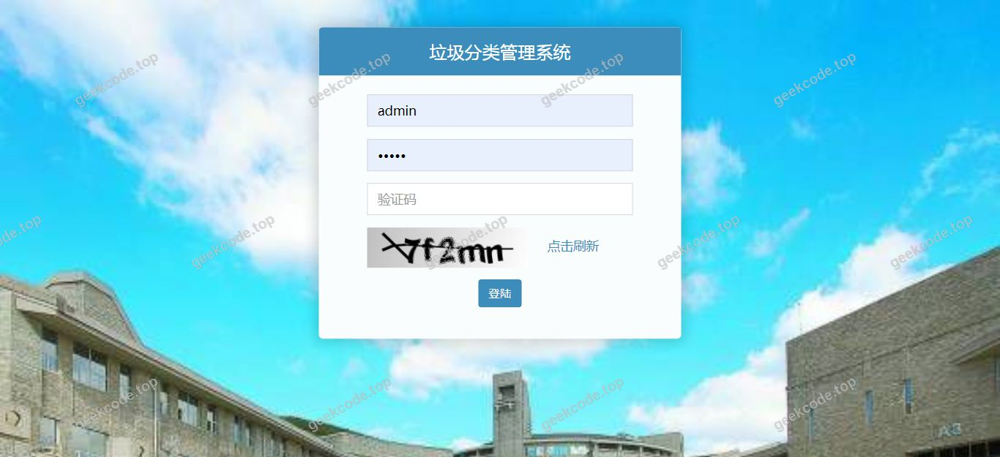
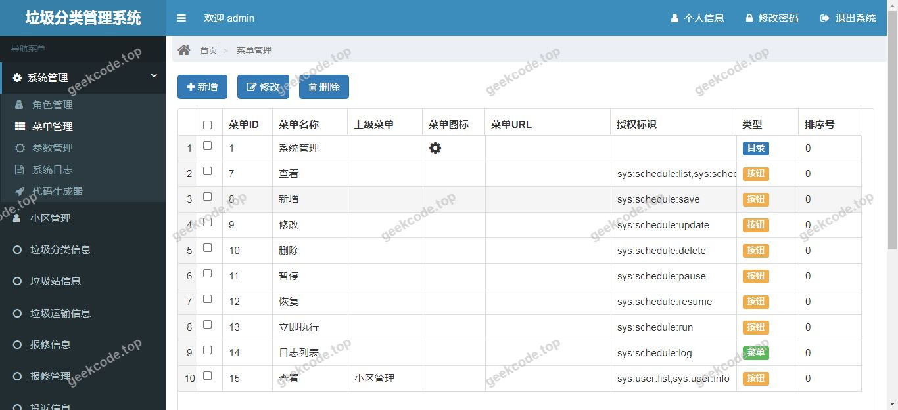
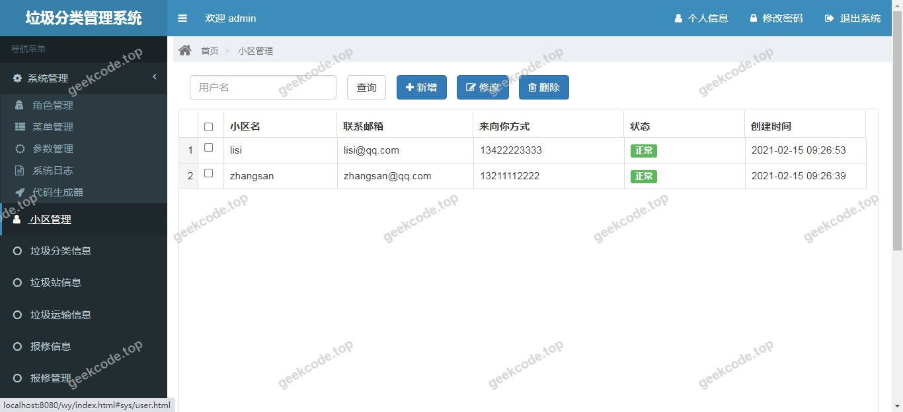
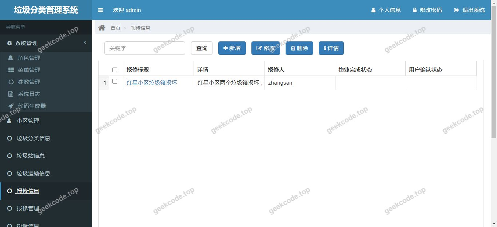

# java【毕业设计】精品项目-基于ssm+shiro的垃圾分类管理系统(带论文)

> 🎓 **计算机毕业设计 · java【毕业设计】精品项目-基于ssm+shiro的垃圾分类管理系统(带论文)**
>
> 本仓库只放**项目介绍 + 运行截图**（截图是站点带水印的原图，存在仓库 `images/` 里）。
>
> 👉 **完整可运行源码 / 数据库脚本 / 部署文档：[点我获取](https://geekcode.top/archives/java%E3%80%90%E6%AF%95%E4%B8%9A%E8%AE%BE%E8%AE%A1%E3%80%91%E7%B2%BE%E5%93%81%E9%A1%B9%E7%9B%AE-%E5%9F%BA%E4%BA%8Essm-shiro%E7%9A%84%E5%9E%83%E5%9C%BE%E5%88%86%E7%B1%BB%E7%AE%A1%E7%90%86%E7%B3%BB%E7%BB%9F-%E5%B8%A6%E8%AE%BA%E6%96%87?utm_source=github)**
>
> 💬 咨询微信：**ir9372**　|　🌐 更多项目：[极客代码 geekcode.top](https://geekcode.top/?utm_source=github)
>
> 📌 项目详情页：<https://geekcode.top/archives/java%E3%80%90%E6%AF%95%E4%B8%9A%E8%AE%BE%E8%AE%A1%E3%80%91%E7%B2%BE%E5%93%81%E9%A1%B9%E7%9B%AE-%E5%9F%BA%E4%BA%8Essm-shiro%E7%9A%84%E5%9E%83%E5%9C%BE%E5%88%86%E7%B1%BB%E7%AE%A1%E7%90%86%E7%B3%BB%E7%BB%9F-%E5%B8%A6%E8%AE%BA%E6%96%87?utm_source=github>

<table><td width="230" align="center"> <b>扫码加微信 ir9372</b></td><td valign="middle">📦 源码 = 项目介绍 + 全部运行截图 + 数据库 + 部署文档 👉 点上方任意截图，直接跳到 <b>极客代码 geekcode.top</b> 详情页</td></table>

---

<h1>java【毕业设计】精品项目-基于ssm+shiro的垃圾分类管理系统(带论文)</h1>
<h2>项目概述</h2>

本项目为基于 SSM（Spring + Spring MVC + MyBatis）框架结合 Apache Shiro 安全框架开发的垃圾分类管理系统。项目旨在通过信息化手段解决社区或学校等场景下的垃圾分类管理难题，实现分类知识的普及、投放记录的追踪以及系统的安全管控。核心功能包括用户身份认证、权限控制及垃圾分类业务逻辑处理。适用人群主要为需要实施精细化垃圾分类管理的机构管理员及参与分类的普通用户。技术架构采用经典的后端分层设计，前端使用 Thymeleaf 模板引擎进行页面渲染，后端通过 MyBatis 完成数据持久化，Shiro 负责会话管理与访问控制，确保系统运行的安全性与稳定性。

<h2>技术架构</h2>

<strong>前后端架构描述</strong>
系统采用 B/S（Browser/Server）架构模式。前端层基于 Thymeleaf 模板引擎构建动态网页，直接由 Spring MVC 控制器返回视图对象进行渲染，无需独立的前端工程编译步骤，简化了部署流程。后端层严格遵循 MVC 设计模式：Controller 层接收 HTTP 请求并调用 Service 层业务逻辑；Service 层处理核心业务规则；DAO 层通过 MyBatis 映射文件执行 SQL 操作。整体架构轻量且耦合度低，便于维护与扩展。

<strong>数据库设计要点</strong>
数据库选型为 MySQL，主要存储用户信息、角色权限数据以及垃圾分类相关业务数据。利用 Druid 连接池管理数据库连接，提高并发访问性能。MyBatis 作为 ORM 框架，通过 XML 配置文件或注解方式将 Java 对象与数据库表进行映射，支持复杂的 SQL 查询优化，确保数据存取的高效性与准确性。

<strong>核心技术选型理由</strong>

<ol>
<li><strong>SSM 框架</strong>：Spring 提供 IOC 容器和 AOP 支持，实现组件解耦；Spring MVC 清晰分离模型、视图与控制器；MyBatis 灵活可控，适合复杂查询场景。</li>
<li><strong>Apache Shiro</strong>：相比 Spring Security，Shiro 更轻量且易于集成，提供了强大的认证、授权、加密和会话管理功能，能有效保障系统安全。</li>
<li><strong>Thymeleaf</strong>：作为服务器端 Java 模板引擎，能自然地在浏览器中查看原型，同时与 Spring Boot/Spring MVC 无缝集成，开发效率高。</li>
<li><strong>Druid</strong>：阿里巴巴开源的高性能 JDBC 连接池，具备监控功能，有助于排查数据库性能瓶颈。</li>
</ol>
<h2>功能模块</h2>

根据现有源码配置与截图显示，系统未明确划分独立的“前台用户端”与“后台管理端”路由结构，而是作为一个统一的 Web 应用运行。主要功能模块如下：

<strong>1. 系统运行界面展示模块</strong>
包含多个系统运行状态界面（截图标识为 front 1-7），展示系统的实际交互页面。这些界面涵盖了用户登录、主菜单导航、业务操作入口等核心视图。具体页面内容依据 Thymeleaf 模板渲染生成，呈现垃圾分类相关的管理操作界面。

<strong>2. 身份认证与会话管理模块</strong>
基于 Shiro 框架实现用户的登录验证、登出操作以及当前会话状态的保持。确保只有经过合法认证的用户才能访问受保护的系统资源。

<strong>3. 基础业务处理模块</strong>
依托 Spring MVC 控制器处理来自前端的表单提交与数据查询请求，通过 MyBatis 与数据库交互，完成垃圾分类信息的增删改查等业务逻辑。由于缺乏具体的路由定义文档，具体细分的业务子模块（如分类知识浏览、投放记录统计等）需以实际代码中的 Controller 方法为准，此处仅概括其底层支撑能力。

<h2>用户角色与权限</h2>

系统基于 Apache Shiro 框架实现细粒度的访问控制。虽然具体角色名称未在配置文件中显式列出，但根据 Shiro 的标准实践及系统性质，可推断存在以下权限层级：

<strong>1. 超级管理员/系统管理者</strong>

<ul>
<li><strong>权限范围</strong>：拥有最高权限，可访问所有系统功能模块。</li>
<li><strong>具体功能</strong>：用户账户管理、角色分配、系统参数配置、查看所有业务数据、执行敏感操作（如删除数据）。</li>
</ul>

<strong>2. 普通用户/操作员</strong>

<ul>
<li><strong>权限范围</strong>：受限访问，仅能执行日常业务操作。</li>
<li><strong>具体功能</strong>：登录后查看个人信息、浏览垃圾分类指南、提交或查询自身的分类记录、修改个人密码。无法访问后台配置或他人数据。</li>
</ul>

<strong>3. 游客/未认证用户</strong>

<ul>
<li><strong>权限范围</strong>：无权限访问任何受保护资源。</li>
<li><strong>具体功能</strong>：仅能访问登录页面或公开的介绍页面。尝试访问其他路径将被 Shiro 拦截并重定向至登录页。</li>
</ul>

<em>注：具体角色与功能的映射关系依赖于数据库中 <code>user</code>、<code>role</code>、<code>permission</code> 表的初始数据配置，上述描述基于 Shiro 通用权限模型推导。</em>

<h2>项目特色与创新点</h2>

<strong>1. 安全机制的内建化</strong>
引入 Apache Shiro 框架而非简单的 Session 检查，实现了标准化的认证与授权流程。支持记住我（Remember Me）、会话超时管理等高级特性，显著提升了系统的安全性，防止未授权访问。

<strong>2. 轻量级全栈整合</strong>
摒弃了微服务架构的复杂性，采用经典的单体 SSM 架构配合 Thymeleaf，实现了后端逻辑与前端展示的紧密耦合。这种架构对于中小型毕业设计项目而言，降低了部署难度，减少了前后端分离带来的接口联调成本，提高了开发效率。

<strong>3. 高性能数据访问</strong>
集成 Druid 数据库连接池，不仅提供了高效的连接复用机制，还内置了监控统计功能，便于开发者实时观察 SQL 执行效率与系统负载情况，为性能优化提供了数据支持。

<h2>部署环境</h2>

为确保系统正常运行，需准备以下软件环境：

<strong>1. 开发工具</strong>

<ul>
<li>IDE: IntelliJ IDEA 或 Eclipse (推荐版本较新以支持 Maven 项目)</li>
<li>JDK: Java Development Kit 1.8 或以上版本</li>
<li>Build Tool: Maven 3.6+</li>
</ul>

<strong>2. 运行时环境</strong>

<ul>
<li>Web Server: Tomcat 8.5 或 9.0 (Servlet 容器)</li>
<li>Database: MySQL 5.7 或 8.0</li>
<li>Browser: Chrome, Firefox, Edge 等主流现代浏览器</li>
</ul>

<strong>3. 依赖库说明</strong>
项目已通过 Maven 管理依赖，主要包括：

<ul>
<li>Spring Framework (Core, Web, JDBC, Context)</li>
<li>MyBatis &amp; MyBatis-Spring</li>
<li>Apache Shiro (Core, Web, Spring)</li>
<li>Druid Connection Pool</li>
<li>Thymeleaf Template Engine</li>
<li>Hibernate Validator (用于参数校验)</li>
<li>JUnit (单元测试)</li>
</ul>
<h2>五、技术特性</h2>
<ul>
<li>服务端模板渲染（Thymeleaf）</li>
<li>集成 Shiro 权限框架实现角色权限控制</li>
</ul>
<h2>六、功能模块截图</h2>
<h3>前台用户端</h3>
<h4>系统运行界面1</h4>

<h4>系统运行界面2</h4>

<h4>系统运行界面3</h4>

<h4>系统运行界面4</h4>

<h4>系统运行界面5</h4>

<h4>系统运行界面6</h4>

<h4>系统运行界面7</h4>

---

## 获取完整源码

| 项目 | 说明 |
| --- | --- |
| 项目名 | java【毕业设计】精品项目-基于ssm+shiro的垃圾分类管理系统(带论文) |
| 运行截图 | 本文 7 张（站点带水印原图，仓库 `images/` 目录） |
| 完整源码 | [https://geekcode.top/archives/java%E3%80%90%E6%AF%95%E4%B8%9A%E8%AE%BE%E8%AE%A1%E3%80%91%E7%B2%BE%E5%93%81%E9%A1%B9%E7%9B%AE-%E5%9F%BA%E4%BA%8Essm-shiro%E7%9A%84%E5%9E%83%E5%9C%BE%E5%88%86%E7%B1%BB%E7%AE%A1%E7%90%86%E7%B3%BB%E7%BB%9F-%E5%B8%A6%E8%AE%BA%E6%96%87?utm_source=github](https://geekcode.top/archives/java%E3%80%90%E6%AF%95%E4%B8%9A%E8%AE%BE%E8%AE%A1%E3%80%91%E7%B2%BE%E5%93%81%E9%A1%B9%E7%9B%AE-%E5%9F%BA%E4%BA%8Essm-shiro%E7%9A%84%E5%9E%83%E5%9C%BE%E5%88%86%E7%B1%BB%E7%AE%A1%E7%90%86%E7%B3%BB%E7%BB%9F-%E5%B8%A6%E8%AE%BA%E6%96%87?utm_source=github) |
| 咨询微信 | **ir9372**（备注：jingpin-yuanma） |
| 更多项目 | [极客代码 geekcode.top](https://geekcode.top/?utm_source=github) |

> 需要源码、部署、改配置、跑不起来等问题，加微信 ir9372 沟通，说明项目名即可。
